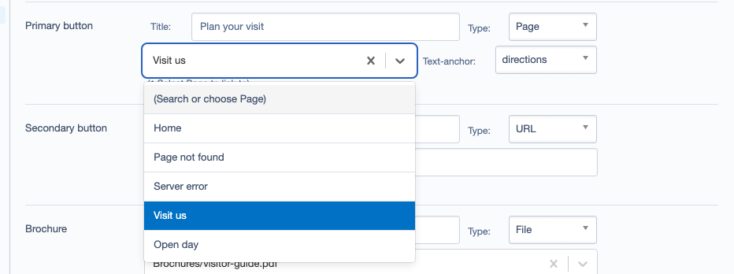

# Named link field for Silverstripe

One field for a link and its text. Editors give the link a title and pick what it points to: a page
(optionally an anchor on that page), a file, a URL, an e-mail address or a shortcode. It is stored
in a single composite database field on your page or record, and a template needs nothing more than
`$Link.URL` and `$Link.Title`.


*Maintained by [Restruct](https://github.com/restruct). If this module saves you time, you can
[support ongoing maintenance](https://github.com/sponsors/restruct).*

## A button is more than a URL

A call to action, a "read more" link or a download button needs two things: the text the visitor
sees, and where it goes. In plain Silverstripe that is several fields: a `has_one` to a page for an
internal link, a text field for an external URL, another for the link text, and template logic that
works out which one the editor filled in. Add a link to a file, an e-mail address or a specific
section of a page, and every such link costs a handful of fields and some `<% if %>` blocks.

This module puts all of that in one field type, `NamedLinkField`, with one CMS field that shows only
the inputs for the link type the editor picked.

## Title, link type and target in one field

The CMS field has a **Title** and a **Type**, and below them the input for that type:

| Type | What the editor picks or enters | `$Link.URL` gives |
|------|---------------------------------|-------------------|
| Page | a page from the site tree, plus an optional text anchor on that page | the page's absolute URL, with `#anchor` when one is chosen |
| URL | any URL | that URL |
| File | a file from Files (shown by its path, e.g. `Brochures/visitor-guide.pdf`) | the file's absolute URL |
| Email | an e-mail address | `mailto:` plus the address, only when it is a valid address |
| Shortcode | a shortcode, e.g. `[sitetree_link,id=1]` | nothing; use `$Link.ShortcodeOutput` |

Switching the type swaps the inputs in place. The page and the file are chosen from the CMS's own
tree pickers:



The **Text-anchor** dropdown lists the anchors in the chosen page's Content: every `id="..."` and
`name="..."` attribute. Picking another page reloads the list straight away, without saving first.

The field works wherever a CMS form does: on pages, and on records edited in a ModelAdmin or a
GridField.

## Using it

### Add a link to a page or record

Declare it as a `db` field:

```php
use Restruct\SilverStripe\ORM\FieldType\NamedLinkField;

private static $db = [
    'PrimaryButton' => NamedLinkField::class,
];
```

Build the database. Scaffolding then adds the CMS field by itself, labelled from `field_labels` or
else from the field name (here "Primary button"). On Silverstripe 6 that includes pages, where it
lands after Content.

To place or label it yourself, add your own. It replaces the scaffolded field of the same name,
wherever that is in the form:

```php
use Restruct\SilverStripe\Forms\NamedLinkFormField;

public function getCMSFields()
{
    $fields = parent::getCMSFields();

    $fields->insertBefore('Content', NamedLinkFormField::create('PrimaryButton', 'Primary button'));

    return $fields;
}
```

Before 3.0.5 (2.1.6 on the `v2` line) the scaffolded field stayed, and the form threw "a field
called 'PrimaryButtonTitle' appears twice"
([#53](https://github.com/restruct/silverstripe-namedlinkfield/issues/53)). On those versions,
call `$fields->removeByName('PrimaryButton')` before adding your own.

### Output it in a template

```html
<% if $PrimaryButton %>
    <a href="$PrimaryButton.URL" class="button">$PrimaryButton.Title</a>
<% end_if %>
```

`<% if $PrimaryButton %>` is true once a page, a file, a URL/e-mail address or a shortcode and title
are set. More is available on the field:

| In a template | Gives |
|---------------|-------|
| `$Link.Title` | the link text the editor entered |
| `$Link.URL` | the link target (see the table above) |
| `$Link.Linkmode` | `Page`, `URL`, `File`, `Email` or `Shortcode` |
| `$Link.Page` | the linked page, e.g. `$Link.Page.MenuTitle` |
| `$Link.PageAnchor` | the chosen anchor, without `#` |
| `$Link.File` | the linked file, e.g. `$Link.File.Title`, `$Link.File.Size` |
| `$Link.Email` | `mailto:` plus the address (Email links only) |
| `$Link.ShortcodeOutput` | the parsed shortcode (Shortcode links only) |

`$Link.URL` is escaped once by the template, so it is safe in an attribute as shown above;
`$Link.URL.RAW` gives the URL as stored. In PHP, `getURL()` returns the raw URL (for a redirect or an
API payload): escape it yourself before echoing it into HTML.

## Technical

### Version compatibility

| Branch | Module version | Silverstripe | PHP |
|--------|----------------|--------------|-----|
| `main` | `3.x` | `^6` | `^8.3` |
| `v2` | `2.1.x` | `^4 \|\| ^5` | `>=7.4` |

Silverstripe 6 required breaking changes here (typed method signatures and `ModelData`), so the
lines are split rather than shared. `v2` receives security and bug fixes until Silverstripe 5
reaches end of life in April 2027; new work goes on `main`.

**`composer.json` is the source of truth** for exact constraints; this table is a quick reference.

### Requirements and installation

- Silverstripe 6 (`silverstripe/framework` `^6`) with the CMS, PHP 8.3+
- [sheadawson/silverstripe-dependentdropdownfield](https://github.com/sheadawson/silverstripe-dependentdropdownfield)
  `^4` for the anchor dropdown, installed with the module

```bash
composer require restruct/silverstripe-namedlinkfield
```

Then flush and build the database (`sake db:build --flush`).

### How it is stored

A field named `PrimaryButton` adds these columns to the record's table: `PrimaryButtonTitle`,
`PrimaryButtonLinkmode`, `PrimaryButtonPageID`, `PrimaryButtonPageAnchor`, `PrimaryButtonFileID`,
`PrimaryButtonCustomURL` (the URL or the e-mail address) and `PrimaryButtonShortcode`. Values older
versions stored as link type `internal` or `external` are read as `Page` and `URL`.

The page and file are stored by ID, not by URL, so a link follows its page when the page moves or is
renamed.

The module adds its JavaScript and CSS to every CMS screen (`LeftAndMain.extra_requirements_*`) and
one route, `admin/namedlinkpageanchors?pid=<page ID>`, which returns a page's anchors as JSON to
users with access to the Pages section (`CMS_ACCESS_CMSMain`).

### Upgrading from SilverStripe 3

The classes were namespaced in the SilverStripe 4 version. `.upgrade.yml` maps the old names for
the upgrader tool: `NamedLinkField` is now `Restruct\SilverStripe\ORM\FieldType\NamedLinkField`,
`NamedLinkFormField` is now `Restruct\SilverStripe\Forms\NamedLinkFormField`.

### Not (yet) supported

- The labels in the field are English only; it is not translatable yet.
- The File type picks an existing file; uploading a new file from within the field is not possible.

### Running the tests

The module needs a host Silverstripe project. Require it there through a Composer **path repository
with `symlink: true`** - `/tests` is `export-ignore`, so a dist or mirrored install has no tests -
add its test namespace to the host's `autoload-dev`, then:

```bash
SS_PHPUNIT_FLUSH=1 vendor/bin/phpunit --testsuite namedlinkfield
```

CI runs the same suite on every push; see `.github/workflows/ci.yml`.

Browser tests (Playwright, against a real CMS) live in `tests/browser/` and run in
`.github/workflows/browser-tests.yml`. The screenshots in this README are generated from the same
fixtures; see [tests/browser/screenshots/README.md](tests/browser/screenshots/README.md) to
regenerate them.

### Credits and license

Started from the LinkField module by Simon Elvery and Left, Right Centre.

Release history: [CHANGELOG.md](CHANGELOG.md). BSD-3-Clause, see [LICENSE](LICENSE).
